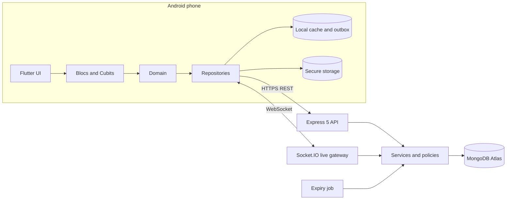
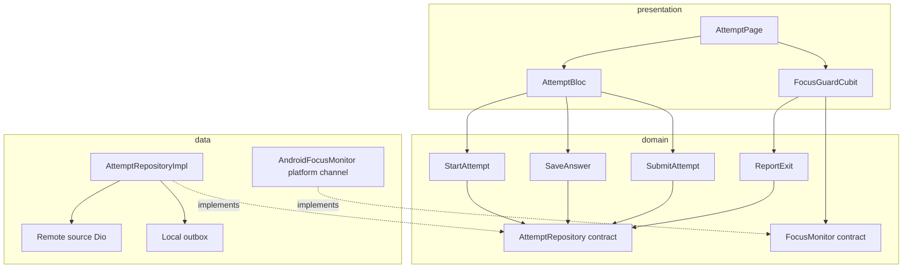

# Evalio - Architecture

## 1. System overview


## 2. API structure
```
api/src/
  config/            validated environment
  core/              errors, auth middleware, validation, pagination, logger
  modules/<name>/    <name>.routes.ts  .controller.ts  .service.ts  .model.ts  .schema.ts  .policy.ts
    auth users courses enrollments quizzes questions attempts grading live
    admin super gradesheets appeals      (SHOULD)
  jobs/              expire-attempts.ts
  app.ts  server.ts
api/test/            integration tests per module
```
Dependency direction: routes -> controllers -> services -> models. Business rules and authorization live in services and policies.

## 3. App structure
```
app/lib/
  core/              di, router, network, error, storage, theme, widgets
  features/<name>/
    domain/          entities, repository contracts, use cases   (no Flutter, no Dio)
    data/            DTOs, remote and local sources, repository implementations
    presentation/    blocs, pages, widgets
```

## 4. Layers of one feature (attempt)


## 5. Architecture decisions
| ID | Decision | Reason | Trade-off |
|---|---|---|---|
| AD1 | Server-authoritative timer | Phone clock is untrusted | Needs clock offset for display |
| AD2 | Save each answer immediately | Exit, crash and network loss must not erase work | More requests |
| AD3 | Questions copied into the attempt as an order list, quiz frozen after first start | Stable grading | No late edits |
| AD4 | Attempt expiry both lazy (on access) and by a periodic job | Works even if the host sleeps | Idempotent finalisation required |
| AD5 | Socket.IO for live mode | Rooms, reconnection, acknowledgements | Single instance for now; adapter needed to scale |
| AD6 | MongoDB transactions for finalisation and grade revision | Consistency | Replica set needed in tests |
| AD7 | Small platform channel for focus and `FLAG_SECURE` | Full control, explainable | Native Kotlin code to maintain |
| AD8 | Integer grade storage in hundredths | No floating-point drift | Conversion at the edges |
| AD9 | Append-only grade revisions and sheet snapshots | Auditability | More storage |

## 6. Offline behaviour
- Course list: cache then network.
- During an attempt: unsent answers are queued in order and shown as "pending"; they are retried with backoff.
- Answers arriving after the deadline are rejected: the app tells the student, and the teacher sees the rejection log.
- Starting an attempt requires a network connection. Correct answers are never cached.

## 7. Deployment
| Part | Proposal |
|---|---|
| API | Docker image (`api/Dockerfile`, target `runtime`) on HTTPS hosting with WebSocket support (for example Render); check free-tier sleep before the defence |
| Database | MongoDB Atlas (production); `docker-compose.yml` runs a local single-node replica set |
| App | Signed release APK attached to the GitHub release |
| Config | Environment variables; `--dart-define=API_URL=...` |
| CI | GitHub Actions on every pull request (includes a Docker image build) |
