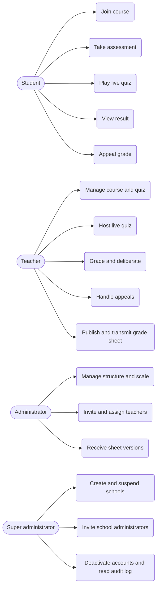
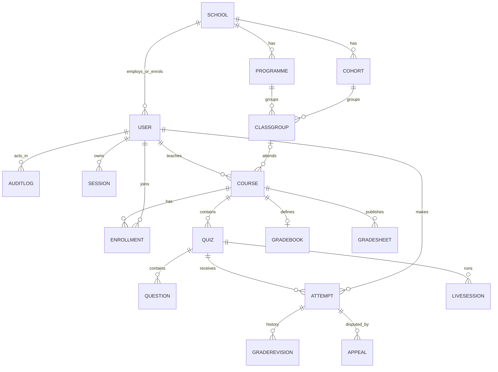
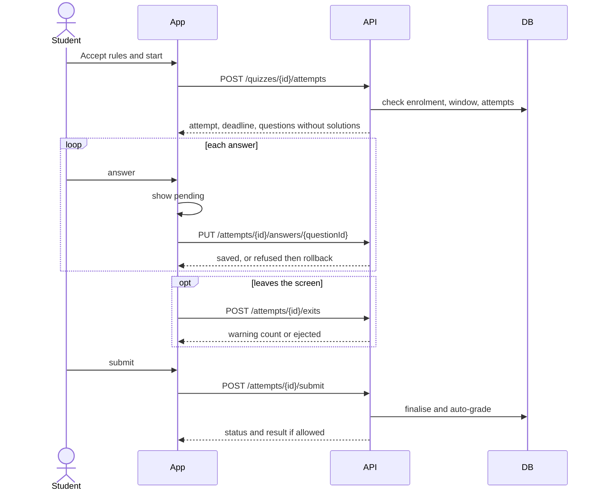
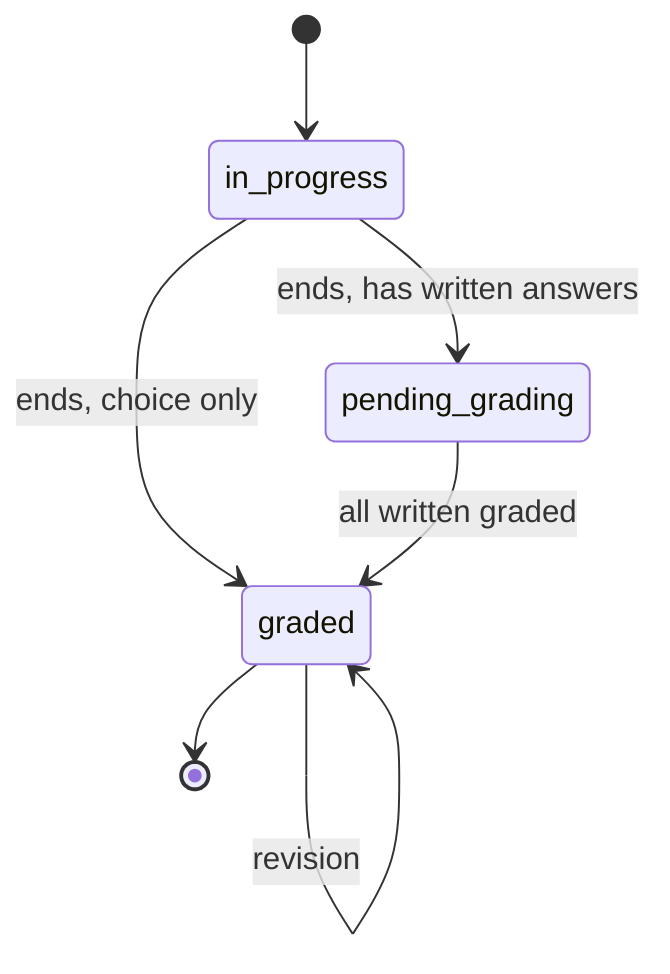
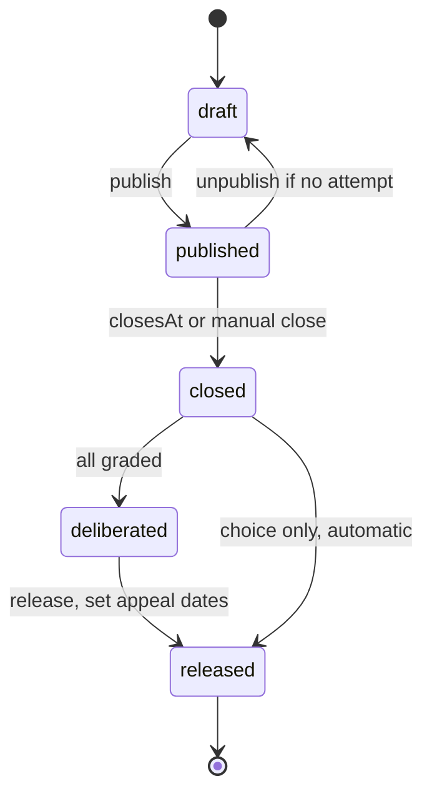
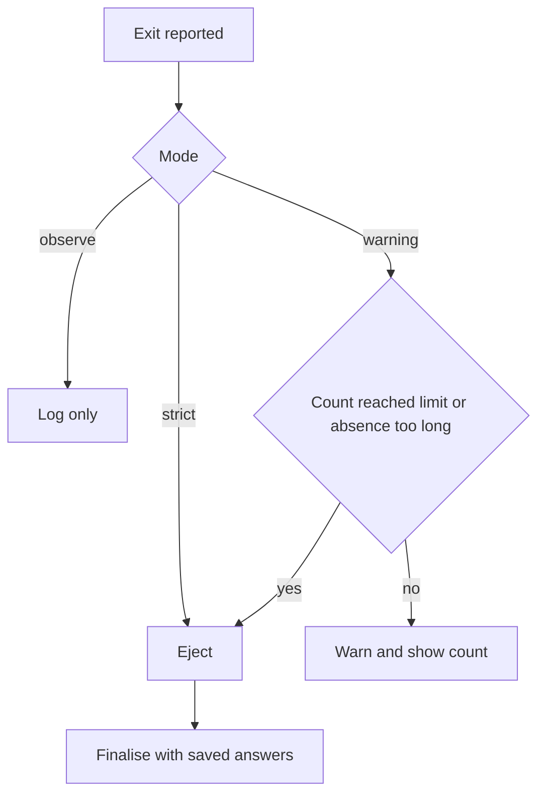
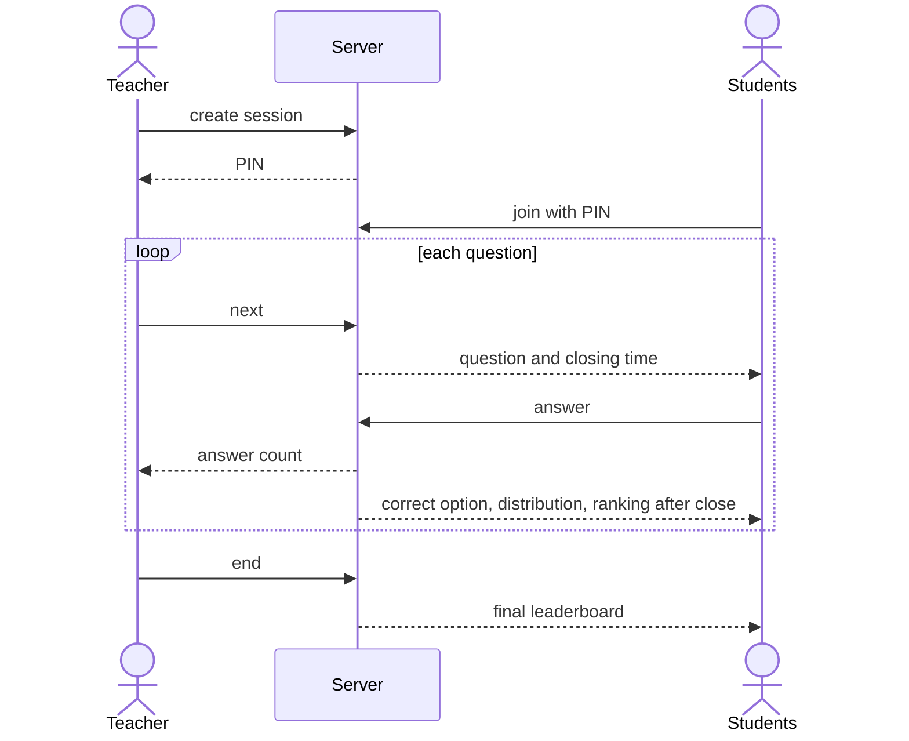
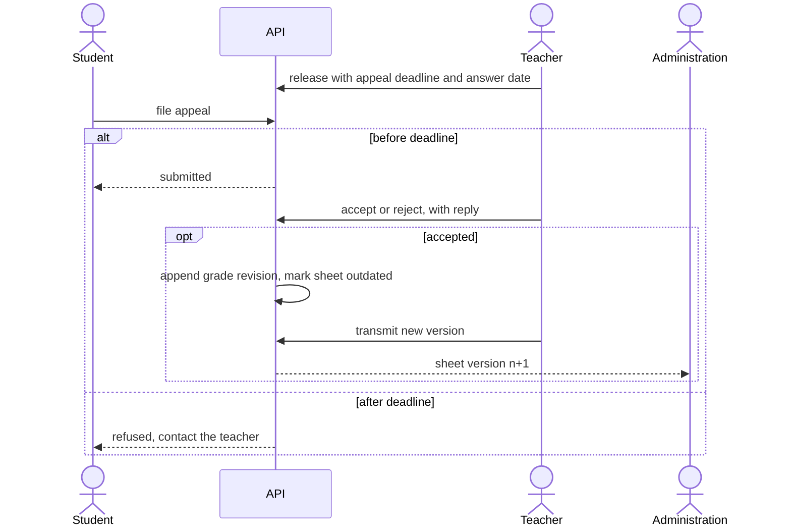

# Evalio - Diagrams

## 1. Use cases

## 2. Entity relationships

## 3. Taking an assessment

## 4. Attempt states

## 5. Assessment states

With immediate release, a student of a choice-only quiz sees their own score at submission, while the quiz stays `published`.

## 6. Focus decision

## 7. Live quiz

## 8. Grade appeal and revision

