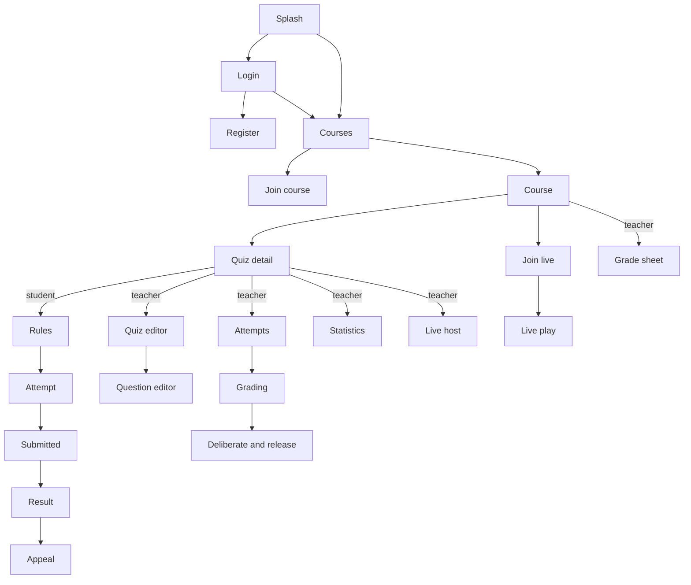

# Evalio - App UX, Navigation and State

## 1. Navigation map

Administrator and super administrator flows, and every screen with its route, are in [14-ui-design.md](14-ui-design.md). The router guard redirects signed-out users to Login. During an attempt, back navigation opens a confirmation.

## 2. Wireframes (low fidelity)
```
COURSES                         RULES BEFORE START
+---------------------------+   +---------------------------+
| My courses        [user]  |   | Mobile Dev - Test 1       |
| [ Search...             ] |   | 30 min - 20 questions     |
| +-----------------------+ |   | Full screen required      |
| | Mobile Development    | |   | Mode: warning             |
| | 2 open assessments    | |   | 3rd exit ends the test    |
| +-----------------------+ |   | Calls may count as exits  |
|              [+ Join/New] |   | [ ] I understand          |
+---------------------------+   | [ Start ]                 |
                                +---------------------------+
ATTEMPT                         WARNING
+---------------------------+   +---------------------------+
| 4/20     12:41    Saved   |   |  You left the test        |
| Which layer holds ...?    |   |  Warning 2 of 3           |
|  ( ) Presentation         |   |  Next exit ends the test  |
|  (x) Domain               |   |  [ Return to the test ]   |
|  ( ) Data                 |   +---------------------------+
| [Prev]     [Grid]  [Next] |
+---------------------------+
QUIZ EDITOR                     GRADING
+---------------------------+   +---------------------------+
| Title [               ]   |   | Student 3/42      Q5      |
| Opens [..]  Closes [..]   |   | Answer: .................  |
| Duration [30] min         |   | Points [ 3.5 ] / 5        |
| Mode [warning v] Exits[3] |   | Comment [              ]  |
| Questions (12)      [+]   |   | [Previous]        [Save]  |
| [ Save ]      [ Publish ] |   +---------------------------+
+---------------------------+
LIVE PLAY                       RESULT
+---------------------------+   +---------------------------+
| Q3          00:12         |   | Test 1        15.50 / 20  |
| ...question...            |   | Q1  2/2                   |
| [A]            [B]        |   | Q2  0/2  see correction   |
| [C]            [D]        |   | Appeal until 18 Dec       |
| 31 of 42 answered         |   | [ Appeal ]                |
+---------------------------+   +---------------------------+
```

## 3. Features and blocs
| Feature | Bloc / Cubit | Notable events or states | Transformer |
|---|---|---|---|
| auth | AuthBloc, LoginCubit | signed in, signed out, expired | droppable login |
| courses | CourseListBloc | cache then network, search, next page | debounce search, droppable paging |
| join | JoinCourseCubit | invalid code, already joined | - |
| quiz authoring | QuizEditorBloc | draft, publish, field errors | sequential |
| attempt | AttemptBloc | optimistic save, rollback, deadline | sequential saves, droppable submit; debounce written text |
| focus | FocusGuardCubit | warning n, ejected | - |
| grading | GradingBloc | per answer save, deliberate | sequential |
| results | ResultCubit, StatsCubit | not released, content | - |
| live | LiveBloc | lobby, question, review, ended, reconnecting | sequential socket events |
| appeals (SHOULD) | AppealCubit | open, closed, status | droppable |
| grade sheet (SHOULD) | GradeSheetBloc | pending cells, outdated | - |

## 4. Required screen states
| Screen | Empty | Error |
|---|---|---|
| Courses | "Join your first course" or "Create a course" | Cached list with offline banner and retry |
| Course | "No assessment yet" | Retry |
| Attempt | - | "Pending" badge, retry, never silent loss |
| Grading | "Nothing left to grade" | Retry, input kept |
| Live | "Waiting for the host" | "Reconnecting" |
| Appeals | "No appeal" | Retry |

## 5. Accessibility and wording
Touch targets of 48 dp or more, scalable text, labels for icons, status shown with text and icon, timer announced at 5 minutes and 1 minute, plain language that explains why an attempt ended.
