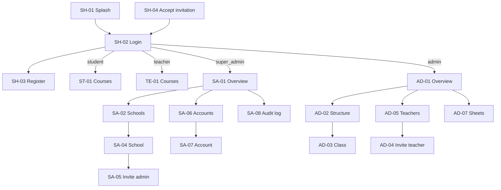
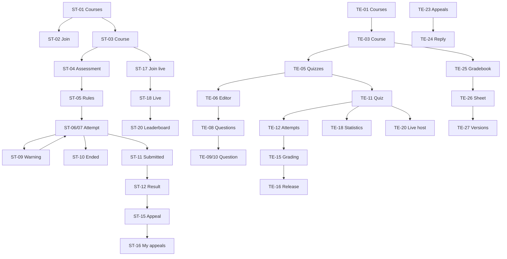

# Evalio - UI Design

Low-fidelity wireframes of all 82 screens, in Markdown so they are versioned and reviewed like any other document. Screen IDs are stable: use them in issues and pull requests. Behaviour, blocs and states are in [07-ux.md](07-ux.md); endpoints in [06-api-contract.md](06-api-contract.md). Data in the mockups is fictitious.

## 1. Design principles
- Android, Material 3, one primary action per screen, bottom navigation with at most four items.
- Status is always shown with text and an icon, never by colour alone (NFR-05).
- Touch targets are at least 48 dp; text scales without clipping.
- Every data screen has loading, empty, error with retry and content (see section 6).
- The attempt screen is immersive: no bottom navigation, timer and save status always visible.
- Wording explains why: why an attempt ended, why a result is not visible yet.

## 2. Interfaces by role
The app has **82 screens** for five kinds of user. The same Android app shows only the screens of the signed-in role.

| Role | Screens | Count |
|---|---|---|
| Shared | SH-01..05 | 5 |
| Student | ST-01..21 | 21 |
| Teacher | TE-01..27 | 27 |
| School administrator (SHOULD) | AD-01..07 | 7 |
| Super administrator (SHOULD) | SA-01..09 | 9 |
| Required states | STA-01..13 | 13 |

### Shared
| ID | Interface | Purpose |
|---|---|---|
| SH-01 | Splash | Start-up, session check |
| SH-02 | Login | Sign in |
| SH-03 | Register | Student self-registration |
| SH-04 | Accept invitation | Teacher or administrator activates an invited account |
| SH-05 | Profile and settings | Account, language, sign out |

### Student
| ID | Interface | Purpose |
|---|---|---|
| ST-01 | Courses | Courses joined, search, offline cache |
| ST-02 | Join a course | Enter a join code |
| ST-03 | Course | Assessments, live entry, grade sheet |
| ST-04 | Assessment detail | Duration, window, attempts left |
| ST-05 | Rules before start | Read and confirm focus rules |
| ST-06 | Attempt, choice | Answer a choice question with timer |
| ST-07 | Attempt, written | Write an answer, pending-save badge |
| ST-08 | Question grid | Jump between questions, submit |
| ST-09 | Warning after exit | Warn on leaving the test |
| ST-10 | Attempt ended | Explain why it ended |
| ST-11 | Submitted | Confirmation |
| ST-12 | Result | Score, grade, per-question result |
| ST-13 | Result not released | Waiting state |
| ST-14 | Copy and correction | Own copy and correct answers |
| ST-15 | Appeal form | File an appeal |
| ST-16 | My appeals | Appeal status |
| ST-17 | Join live | Enter a PIN |
| ST-18 | Live, question | Answer in real time |
| ST-19 | Live, after question | Correct answer, distribution, rank |
| ST-20 | Live, leaderboard | Final ranking |
| ST-21 | Published grade sheet | Class list in school format |

### Teacher
| ID | Interface | Purpose |
|---|---|---|
| TE-01 | Courses | Own courses, search |
| TE-02 | Create course | New course |
| TE-03 | Course | Join code, quizzes, members, sheet |
| TE-04 | Members | Enrolled students, removal |
| TE-05 | Quiz list | Quizzes by status |
| TE-06 | Quiz editor, details | Title, window, duration, attempts |
| TE-07 | Quiz editor, rules and focus | Focus mode, release, shuffling |
| TE-08 | Question list | Order and frozen state |
| TE-09 | Question editor, choice | Options and correct answers |
| TE-10 | Question editor, written | Written question and grading notes |
| TE-11 | Quiz detail | Status and actions |
| TE-12 | Attempts monitor | Live follow-up, exits, heartbeat gaps |
| TE-13 | Attempt detail | Exit log, ejection |
| TE-14 | Grant attempt | Extra attempt with reason |
| TE-15 | Grading | Grade written answers |
| TE-16 | Deliberate and release | Check, then release results |
| TE-17 | Revision history | Grade changes |
| TE-18 | Statistics | Per question and per student |
| TE-19 | Leaderboard | Ranking |
| TE-20 | Live host, lobby | PIN and participants |
| TE-21 | Live host, question | Run a question |
| TE-22 | Live host, review | Distribution and ranking |
| TE-23 | Appeals inbox | Appeals to review |
| TE-24 | Appeal reply | Accept or reject with reply |
| TE-25 | Gradebook components | Weighted components |
| TE-26 | Grade sheet draft | Cells and final average |
| TE-27 | Transmitted versions | Send versions, export PDF |

### School administrator (SHOULD)
| ID | Interface | Purpose |
|---|---|---|
| AD-01 | Overview | Counters and new sheets |
| AD-02 | Structure | Programmes, cohorts, classes |
| AD-03 | Class form | Create or edit a class |
| AD-04 | Invite teacher | Single-use invitation |
| AD-05 | Teachers and assignments | Staff and class assignments |
| AD-06 | Grading scale | Scale and pass mark |
| AD-07 | Received grade sheets | Sheets and versions from teachers |

### Super administrator (SHOULD)
| ID | Interface | Purpose |
|---|---|---|
| SA-01 | Platform overview | Counters only |
| SA-02 | Schools | List and status |
| SA-03 | Create school | New school |
| SA-04 | School detail | Administrators, suspend |
| SA-05 | Invite school administrator | Single-use invitation |
| SA-06 | Accounts | Search all accounts |
| SA-07 | Account detail | Deactivate and revoke sessions |
| SA-08 | Audit log | Read-only action history |
| SA-09 | Confirm suspension | Destructive-action dialog |

### Required states
| ID | Interface | Purpose |
|---|---|---|
| STA-01..13 | State screens | Empty (student, teacher), offline with cache, no assessment, loading, error with retry, nothing to grade, live waiting and reconnecting, no appeal, appeal closed, window closed, back during an attempt |

## 3. Design tokens
| Token | Light | Use |
|---|---|---|
| primary | #0F766E | App bar of attempts, primary buttons, active tab |
| success | #15803D | Correct, saved, released |
| warning | #B45309 | Warnings, pending, outdated |
| error | #B91C1C | Ejection, rejection, destructive actions |
| info | #1D4ED8 | Information, current question |
| background / surface | #EEF1F4 / #FFFFFF | Screens / cards |
| text / muted | #14202B / #5B6B7A | Body / secondary |

Dark theme uses lighter variants of the same roles. Typography: Roboto, Material 3 type scale (title 17 sp, body 14-15 sp, caption 12 sp). Shape: cards 12 dp, buttons fully rounded, fields 10 dp. Spacing grid: 4 dp.

## 4. Navigation by role
| Role | Bottom navigation | Start screen |
|---|---|---|
| Student | Courses, Appeals, Profile | ST-01 |
| Teacher | Courses, Appeals, Profile | TE-01 |
| School administrator | Overview, Structure, Teachers, Sheets | AD-01 |
| Super administrator | Overview, Schools, Accounts, Audit | SA-01 |

The router guard sends signed-out users to SH-02 and each role to its start screen. A route outside the role's area redirects to the start screen (the API still answers 403 or 404).


Student and teacher flows:

Behaviour and blocs are in [07-ux.md](07-ux.md).

## 5. Screens
Each wireframe shows the content and layout; `[ ]` are buttons or fields, `(x)` and `( )` options, `[x]` checkboxes, `(!)` `(i)` `(v)` `(X)` warning, info, success and error banners. Route, Bloc or Cubit, endpoints and requirements are given under each title. Data is fictitious.

### 5.1 Shared screens
Available to every role.

#### SH-01 Splash
Route `/splash` - AuthBloc - GET /me - FR-AUTH-02

```
+------------------------------------+
|                                    |
|                                    |
|         ( E )                      |
|        Evalio                      |
|                                    |
|   Quizzes and assignments          |
|   for your class                   |
|                                    |
|           (spinner)                |
|                                    |
+------------------------------------+
```

#### SH-02 Login
Route `/login` - LoginCubit - POST /auth/login - FR-AUTH-02 - *Error state shown*

```
+------------------------------------+
| Sign in                            |
+------------------------------------+
| Email                              |
| [ amina.test@example.org     ]     |
| Password                           |
| [ ********                   ]     |
| ! Email or password is incorrect   |
|                                    |
| [        Sign in           ]       |
|    Create a student account        |
+------------------------------------+
```

#### SH-03 Register (students)
Route `/register` - RegisterCubit - POST /auth/register - FR-AUTH-01 - *Always creates a student*

```
+------------------------------------+
| < Create account                   |
+------------------------------------+
| Last name   [ Sawadogo        ]    |
| First names [ Aminata         ]    |
| Email       [ name@school.org ]    |
| ! Invalid email                    |
| Password    [                 ]    |
|   10 characters minimum            |
| Student ID  [ (optional)      ]    |
|                                    |
| [     Create account       ]       |
+------------------------------------+
```

#### SH-04 Accept invitation
Route `/invite/:token` - InvitationCubit - POST /invitations/accept - FR-ADM-02, FR-SUP-02 - *Single-use token, 7 days*

```
+-------------------------------------+
| Welcome                             |
+-------------------------------------+
| (i) You were invited as teacher     |
|     by Lycee Demo.                  |
| Email   [ t.ouedraogo@example.org ] |
|   Set by the invitation             |
| Last    [ Ouedraogo ]               |
| First   [ Salif     ]               |
| Password[           ]               |
|                                     |
| [     Activate account     ]        |
+-------------------------------------+
```

#### SH-05 Profile and settings
Route `/profile` - AuthBloc - GET /me, POST /auth/logout - FR-AUTH-04

```
+------------------------------------+
| Profile                            |
+------------------------------------+
| (AS) Aminata Sawadogo   [Student]  |
|      amina.test@example.org        |
| Student ID        2024-0412        |
| School            Lycee Demo       |
| Language          English          |
| About, data and privacy   >        |
|                                    |
| [        Sign out          ]       |
+------------------------------------+
| [Courses] [Appeals] [Profile]      |
+------------------------------------+
```

### 5.2 Student
Join courses, take assessments, see results, appeal, play live.

#### ST-01 Courses
Route `/courses` - CourseListBloc - GET /courses - FR-CRS-04, NFR-04 - *Cache then network*

```
+------------------------------------+
| My courses                 (me)    |
+------------------------------------+
| [ Search courses              ]    |
| +----------------------------+     |
| | Mobile Development  [Open] |     |
| | 2 open assessments         |     |
| +----------------------------+     |
| | Databases           [Idle] |     |
| +----------------------------+     |
| | Algorithms        [Result] |     |
| +----------------------------+     |
|                          [ + ]     |
+------------------------------------+
| [Courses] [Appeals] [Profile]      |
+------------------------------------+
```

#### ST-02 Join a course
Route `/courses/join` - JoinCourseCubit - POST /enrollments - FR-CRS-03 - *Errors: invalid code, already joined*

```
+------------------------------------+
| < Join a course                    |
+------------------------------------+
| Enter the 8-character code         |
| given by your teacher.             |
|                                    |
|    K7M2 Q9XD                       |
|                                    |
| Join code [ K7M2Q9XD         ]     |
| ! Invalid code / Already joined    |
|                                    |
| [          Join            ]       |
+------------------------------------+
```

#### ST-03 Course
Route `/courses/:id` - CourseCubit - GET /courses/:id, GET /courses/:id/quizzes - -

```
+------------------------------------+
| < Mobile Development               |
|   Mr Ouedraogo                     |
+------------------------------------+
| [Assessments]  Grade sheet         |
| +----------------------------+     |
| | Test 1             [Open]  |     |
| | 10 Dec 09:00 - 11:00       |     |
| +----------------------------+     |
| | Quiz: Architecture [Result]|     |
| +----------------------------+     |
| | Live quiz           [Live] |     |
| +----------------------------+     |
| [  Join live with PIN      ]       |
+------------------------------------+
```

#### ST-04 Assessment detail
Route `/quizzes/:id` - QuizCubit - GET /quizzes/:id - -

```
+------------------------------------+
| < Test 1                           |
+------------------------------------+
| Questions      20                  |
| Duration       30 min              |
| Window         10 Dec 09:00-11:00  |
| Attempts       1 of 1 left         |
| Focus mode     [Warning]           |
|                                    |
| Read the rules on the next         |
| screen before you start.           |
|                                    |
| [        Continue          ]       |
+------------------------------------+
```

#### ST-05 Rules before start
Route `/quizzes/:id/rules` - AttemptBloc - POST /quizzes/:id/attempts - FR-FOC-08, FR-ATT-01 - *FR-FOC-08*

```
+------------------------------------+
| < Before you start                 |
+------------------------------------+
| (!) Full screen required.          |
|     Screenshots are blocked.       |
| * Mode: warning                    |
| * The 3rd exit ends the test       |
| * A call may count as an exit      |
| * Network loss is never an exit    |
| * Answers are saved as you go      |
|                                    |
| [x] I understand the rules         |
| [          Start           ]       |
+------------------------------------+
```

#### ST-06 Attempt - choice question
Route `/attempts/:id` - AttemptBloc - PUT /attempts/:id/answers/:q - FR-ATT-02..04 - *Server deadline; immersive*

```
+------------------------------------+
| 4/20          12:41   Saved        |
+------------------------------------+
| Which layer holds business         |
| rules?                             |
| =====-----------------  20%        |
| ( ) Presentation                   |
| (x) Domain                         |
| ( ) Data                           |
|                                    |
| [Prev]     [Grid]     [Next]       |
+------------------------------------+
```

#### ST-07 Attempt - written question
Route `/attempts/:id` - AttemptBloc - same, debounced - FR-ATT-04, FR-ATT-05 - *Never silent loss*

```
+------------------------------------+
| 9/20          08:05  Pending 1     |
+------------------------------------+
| Explain the role of a Bloc in      |
| the presentation layer.            |
| +----------------------------+     |
| | A Bloc receives events...  |     |
| |                            |     |
| +----------------------------+     |
| 412 / 10 000 characters            |
| (!) 1 answer not sent. Retrying.   |
| [Prev]   [Retry now]   [Next]      |
+------------------------------------+
```

#### ST-08 Question grid
Route `/attempts/:id/grid` - AttemptBloc - POST /attempts/:id/submit - FR-ATT-07

```
+------------------------------------+
| 12/20          06:30               |
+------------------------------------+
| QUESTIONS                          |
| [1][2][3][4][5]                    |
| [6][7][8][9][10]                   |
| [11][12][13][14][15]               |
| [16][17][18][19][20]               |
| answered / current / blank         |
|                                    |
| [       Submit test        ]       |
+------------------------------------+
```

#### ST-09 Warning after exit
Route `modal` - FocusGuardCubit - POST /attempts/:id/exits - FR-FOC-04 - *Server counts exits*

```
+------------------------------------+
| (dialog over the test)             |
+------------------------------------+
|                                    |
|        (!)                         |
|   You left the test                |
|   Warning 2 of 3                   |
|   The next exit ends the test      |
|                                    |
| [  Return to the test      ]       |
|                                    |
+------------------------------------+
```

#### ST-10 Attempt ended
Route `/attempts/:id/ended` - AttemptBloc - GET /attempts/:id - FR-ATT-07 - *Explains why it ended*

```
+------------------------------------+
| Test 1                             |
+------------------------------------+
|        (X)                         |
| Your attempt ended                 |
| Reason: you left the test 3        |
| times. 14 of 20 answers were       |
| kept.                              |
| (i) Contact your teacher if this   |
|     was a call or emergency.       |
|                                    |
| [     Back to course       ]       |
+------------------------------------+
```

#### ST-11 Submitted
Route `/attempts/:id/done` - AttemptBloc - POST /attempts/:id/submit - FR-ATT-07

```
+------------------------------------+
| Test 1                             |
+------------------------------------+
|        (v)                         |
|    Test submitted                  |
| 20 of 20 questions answered.       |
| Your teacher will release the      |
| results after grading.             |
|                                    |
| [     Back to course       ]       |
+------------------------------------+
```

#### ST-12 Result
Route `/attempts/:id/result` - ResultCubit - GET /attempts/:id/result - FR-GRD-05

```
+------------------------------------+
| < Test 1 - result                  |
+------------------------------------+
|      15.50 / 20   [B+]             |
| Q1 Choice     2/2     Correct      |
| Q2 Choice     0/2     Wrong        |
| Q9 Written    3.5/5   Comment      |
|                                    |
| Appeal until 18 Dec                |
|                                    |
| [     Appeal a grade       ]       |
+------------------------------------+
```

#### ST-13 Result not released
Route `/attempts/:id/result` - ResultCubit - 403 NOT_RELEASED - FR-GRD-05 - *403 NOT_RELEASED*

```
+------------------------------------+
| < Test 1 - result                  |
+------------------------------------+
|                                    |
|         ( )                        |
| Result not available yet           |
| Your teacher is still grading.     |
| You will see it here when it       |
| is released.                       |
|                                    |
+------------------------------------+
```

#### ST-14 My copy and correction
Route `/attempts/:id/review` - ResultCubit - GET /attempts/:id/result - FR-GRD-05 - *Shown after close if enabled*

```
+------------------------------------+
| < Q2 - correction                  |
+------------------------------------+
| Which package holds DTOs?          |
| (x) data                           |
| ( ) domain                         |
| ( ) presentation                   |
| (v) Correct answer: domain         |
| Teacher comment:                   |
| "See lesson 4, slide 12."          |
| [Prev]               [Next]        |
+------------------------------------+
```

#### ST-15 Appeal form
Route `/attempts/:id/appeal` - AppealCubit - POST /attempts/:id/appeals - FR-APL-02 - *FR-APL-02*

```
+------------------------------------+
| < Appeal                           |
+------------------------------------+
| Assessment [ Test 1          ]     |
| Question   [ Q9 Written      ]     |
| Reason                             |
| +----------------------------+     |
| | My answer covers the three |     |
| | layers as asked.           |     |
| +----------------------------+     |
| Deadline: 18 Dec, 23:59            |
| [       Send appeal        ]       |
+------------------------------------+
```

#### ST-16 My appeals
Route `/appeals` - AppealCubit - GET /appeals - FR-APL-04

```
+------------------------------------+
| Appeals                            |
+------------------------------------+
| [Open]  Decided                    |
| +----------------------------+     |
| | Test 1 - Q9     [Reviewing]|     |
| | Sent 12 Dec                |     |
| +----------------------------+     |
| | Quiz: Architecture [Sent]  |     |
| +----------------------------+     |
|                                    |
+------------------------------------+
| [Courses] [Appeals] [Profile]      |
+------------------------------------+
```

#### ST-17 Join live quiz
Route `/live/join` - LiveBloc - POST /live-sessions/join - FR-LIV-02 - *Rate limited*

```
+------------------------------------+
| < Live quiz                        |
+------------------------------------+
| Enter the PIN shown by your        |
| teacher.                           |
|                                    |
|      4 8 2 9 1 7                   |
|                                    |
| [          Join            ]       |
+------------------------------------+
```

#### ST-18 Live - question
Route `/live/:id` - LiveBloc - WS question:open, answer:submit - FR-LIV-03, 04 - *Solution hidden until close*

```
+------------------------------------+
| Q3            00:12                |
|   31/42 answered                   |
+------------------------------------+
| What does DI stand for?            |
| +-------------++-------------+     |
| | A Dependency|| B Data      |     |
| |   Injection ||   Interface |     |
| +-------------++-------------+     |
| | C Direct    || D Domain    |     |
| |   Input     ||   Index     |     |
| +-------------++-------------+     |
+------------------------------------+
```

#### ST-19 Live - after question
Route `/live/:id` - LiveBloc - WS question:closed - FR-LIV-05, 06

```
+------------------------------------+
| Q3 closed                          |
+------------------------------------+
| (v) Correct! +820 points           |
| Distribution                       |
|   A     B     C     D              |
|   ##    #     .     .              |
|   78%   12%   6%    4%             |
| Your rank   5th of 42   2,340      |
+------------------------------------+
```

#### ST-20 Live - leaderboard
Route `/live/:id` - LiveBloc - WS leaderboard:update - FR-LIV-06 - *Names and scores only*

```
+------------------------------------+
| Final ranking                      |
+------------------------------------+
| 1. Fatoumata B.        3,180       |
| 2. Ibrahim K.          3,060       |
| 3. Esther O.           2,990       |
| 5. You                 2,340       |
|                                    |
| [     Back to course       ]       |
+------------------------------------+
```

#### ST-21 Published grade sheet
Route `/grade-sheets/:id` - GradeSheetBloc - GET /grade-sheets/:id - FR-SHT-04 - *FR-SHT-04*

```
+-------------------------------------+
| < Grade sheet - Mobile Dev v2       |
+-------------------------------------+
| #  Name          Avg  Grade         |
| 1  Bance F.     16.40  A-           |
| 2  Sawadogo A.   15.00  B+   <- you |
| 3  Kone I.      13.20  B-           |
| 4  Ouedraogo E.  9.50  F            |
| Attendance 16 | Particip. 16        |
| Test 1 14 | Test 2 15               |
| Only class members see this list.   |
+-------------------------------------+
```

### 5.3 Teacher
Courses, quizzes, monitoring, grading, live hosting, appeals, grade sheets.

#### TE-01 Courses
Route `/courses` - CourseListBloc - GET /courses - FR-CRS-01, 04

```
+------------------------------------+
| My courses                 (me)    |
+------------------------------------+
| [ Search courses              ]    |
| +----------------------------+     |
| | Mobile Development         |     |
| | MD301 - 42 students        |     |
| +----------------------------+     |
| | Databases      [Archived]  |     |
| +----------------------------+     |
|                          [ + ]     |
+------------------------------------+
| [Courses] [Appeals] [Profile]      |
+------------------------------------+
```

#### TE-02 Create course
Route `/courses/new` - CourseFormCubit - POST /courses - FR-CRS-01

```
+------------------------------------+
| < New course                       |
+------------------------------------+
| Title  [ Mobile Development  ]     |
| Code   [ MD301               ]     |
| Description [ (optional)      ]    |
| Class  [ L3 CS - 2026       v]     |
|                                    |
| [      Create course       ]       |
+------------------------------------+
```

#### TE-03 Course
Route `/courses/:id` - CourseCubit - GET /courses/:id, POST /courses/:id/join-code - FR-CRS-02

```
+------------------------------------+
| < Mobile Development   (...)       |
+------------------------------------+
| [Quizzes] Members  Sheet           |
| Join code   K7M2 Q9XD              |
| [Share]        [Regenerate]        |
| +----------------------------+     |
| | Test 1   18/42  [Published]|     |
| | Quiz: Architecture [Released]    |
| +----------------------------+     |
|                          [ + ]     |
+------------------------------------+
```

#### TE-04 Members
Route `/courses/:id/members` - MembersCubit - GET, DELETE members - FR-CRS-03

```
+-----------------------------------------+
| < Members  (42 students)                |
+-----------------------------------------+
| [ Search students            ]          |
| (AS) Aminata Sawadogo   2024-0412 (...) |
| (IK) Ibrahim Kone       2024-0388 (...) |
| (FB) Fatoumata Bance    2024-0401 (...) |
| Menu: remove from course                |
+-----------------------------------------+
```

#### TE-05 Quiz list
Route `/courses/:id/quizzes` - QuizListBloc - GET /courses/:id/quizzes - -

```
+------------------------------------+
| < Quizzes                          |
+------------------------------------+
| [All] Draft  Open  Closed          |
| Test 1            [Published]      |
| Test 2            [Draft]          |
| Live: revision    [Draft]          |
|                          [ + ]     |
+------------------------------------+
```

#### TE-06 Quiz editor - details
Route `/quizzes/:id/edit` - QuizEditorBloc - PATCH /quizzes/:id - FR-QZ-03..05

```
+------------------------------------+
| < Edit quiz               [Save]   |
+------------------------------------+
| Title    [ Test 1              ]   |
| Opens    [ 10 Dec 2026, 09:00  ]   |
| Closes   [ 10 Dec 2026, 11:00  ]   |
| Duration [ 30 ] min                |
| Attempts [ 1 ]                     |
|                                    |
| [     Rules and focus      ]       |
+------------------------------------+
```

#### TE-07 Quiz editor - rules and focus
Route `/quizzes/:id/rules` - QuizEditorBloc - PATCH /quizzes/:id - FR-FOC-03..05 - *Defaults per PRD section 9; release and shuffle options below*

```
+------------------------------------+
| < Rules and focus                  |
+------------------------------------+
| FOCUS MODE                         |
| ( ) Strict: 1st exit ends          |
| (x) Warning: exit 3 ends           |
| ( ) Observation: logged only       |
| Exit that ends [ 3 ]               |
| Max single absence [ 10 ] s        |
| RESULTS                            |
| (x) After deliberation             |
| ( ) Immediate (choice only)        |
| [x] Shuffle questions / options    |
+------------------------------------+
```

#### TE-08 Question list
Route `/quizzes/:id/questions` - QuizEditorBloc - GET /quizzes/:id/questions - FR-QZ-04

```
+------------------------------------+
| < Questions  (12, 24 points)       |
+------------------------------------+
| 1. Which layer holds ... 2 pts     |
|    Single choice                   |
| 2. Select valid Bloc ...  2 pts    |
|    Multiple choice                 |
| 9. Explain the role ...   5 pts    |
|    Written                         |
| (!) Frozen after first attempt     |
|                          [ + ]     |
+------------------------------------+
```

#### TE-09 Question editor - choice
Route `/questions/:id` - QuestionEditorCubit - POST, PATCH /questions - FR-QZ-01, 02

```
+------------------------------------+
| < Question                [Save]   |
+------------------------------------+
| Type   [ Multiple choice    v]     |
| Text   [ Select valid Bloc ...]    |
| Points [ 2 ]                       |
| [x] Loading                        |
| [x] Success                        |
| [ ] Teleport                       |
| 2 to 8 options, 1+ correct         |
| [        Add option        ]       |
+------------------------------------+
```

#### TE-10 Question editor - written
Route `/questions/:id` - QuestionEditorCubit - POST, PATCH /questions - FR-QZ-01, 02

```
+----------------------------------------+
| < Question                [Save]       |
+----------------------------------------+
| Type   [ Written            v]         |
| Text   [ Explain the role ... ]        |
| Points [ 5 ]                           |
| Grading notes (never sent to students) |
| +----------------------------+         |
| | events, states, separation |         |
| +----------------------------+         |
+----------------------------------------+
```

#### TE-11 Quiz detail
Route `/quizzes/:id` - QuizCubit - publish, close - FR-QZ-03 - *Actions depend on status*

```
+------------------------------------+
| < Test 1                  (...)    |
+------------------------------------+
| Status      [Published]            |
| Window      10 Dec 09:00-11:00     |
| Submitted   18 / 42                |
| In progress 3                      |
|                                    |
| [ Attempts and grading     ]       |
| [       Statistics         ]       |
| [       Close quiz         ]       |
+------------------------------------+
```

#### TE-12 Attempts monitor
Route `/quizzes/:id/attempts` - AttemptsCubit - GET /quizzes/:id/attempts - FR-FOC-07

```
+--------------------------------------+
| < Attempts - Test 1                  |
+--------------------------------------+
| [In progress] Submitted Ejected      |
| Aminata S.  Q12/20  1 exit  [Active] |
| Ibrahim K.  Q9/20   2 exits [!]      |
| Esther O.   no heartbeat 40 s [Gap]  |
| Gaps may be network loss.            |
+--------------------------------------+
```

#### TE-13 Attempt detail
Route `/attempts/:id/detail` - AttemptsCubit - GET /attempts/:id - FR-FOC-02, 06

```
+------------------------------------+
| < Ibrahim Kone - Attempt 1         |
+------------------------------------+
| Started 09:03   Ended [Ejected]    |
| Exits 3   Answers saved 14/20      |
| EXIT LOG                           |
| 09:11:04   4.2 s away              |
| 09:17:30   2.0 s away              |
| 09:22:51   12 s (limit 10 s)       |
|                                    |
| [   Grant new attempt      ]       |
+------------------------------------+
```

#### TE-14 Grant new attempt
Route `/attempts/:id/grant` - GrantCubit - POST /quizzes/:id/grants - FR-ATT-08 - *FR-ATT-08*

```
+------------------------------------+
| < Grant attempt                    |
+------------------------------------+
| Student [ Ibrahim Kone        ]    |
| Extra attempts [ 1 ]               |
| Extra time     [ 0 ] min           |
| Reason (required)                  |
| [ Phone call during the test ]     |
|                                    |
| [          Grant           ]       |
+------------------------------------+
```

#### TE-15 Grading written answers
Route `/quizzes/:id/grading` - GradingBloc - PATCH /attempts/:id/grades/:q - FR-GRD-02

```
+------------------------------------+
| < Grading   Student 3/42  Q9       |
+------------------------------------+
| Explain the role of a Bloc.        |
| Answer: A Bloc receives events     |
| and emits states...                |
| Notes: events, states, separation  |
| Points (max 5) [ 3.5 ]             |
| Comment [ Good, missing testing ]  |
| [Previous]            [Save]       |
+------------------------------------+
```

#### TE-16 Deliberate and release
Route `/quizzes/:id/release` - GradingBloc - deliberate, release - FR-GRD-03, 04 - *Refused with ungraded answers*

```
+------------------------------------+
| < Deliberation                     |
+------------------------------------+
| Graded 42/42   Ungraded written 0  |
| In progress 0   Average 13.4       |
| (v) Ready for deliberation.        |
| Appeal deadline [ 18 Dec 23:59 ]   |
| Answers on      [ 19 Dec       ]   |
|                                    |
| [       Deliberate         ]       |
| [     Release results      ]       |
+------------------------------------+
```

#### TE-17 Grade revision history
Route `/attempts/:id/revisions` - RevisionsCubit - GET /attempts/:id/revisions - FR-GRD-08

```
+------------------------------------+
| < History - Aminata S. Q9          |
+------------------------------------+
| R2  3.5 -> 4.5   12 Dec            |
|     Reason: appeal accepted        |
| R1  3.0 -> 3.5   10 Dec            |
| Entries are never edited.          |
+------------------------------------+
```

#### TE-18 Statistics
Route `/quizzes/:id/stats` - StatsCubit - GET /quizzes/:id/stats - FR-GRD-06

```
+------------------------------------+
| < Statistics - Test 1              |
+------------------------------------+
| [Questions]  Students              |
| Q1  success 92%  ##########        |
| Q2  success 35%  ####              |
| Q9  average 3.4/5 #######          |
| Lowest: Q2. Review in class.       |
+------------------------------------+
```

#### TE-19 Leaderboard
Route `/quizzes/:id/leaderboard` - StatsCubit - GET /quizzes/:id/leaderboard - FR-GRD-07

```
+------------------------------------+
| < Leaderboard - Test 1             |
+------------------------------------+
| 1. Fatoumata B.  18:40   19.0      |
| 2. Ibrahim K.    24:10   17.5      |
| 3. Aminata S.    27:02   17.5      |
| Ranked by score, then duration.    |
+------------------------------------+
```

#### TE-20 Live host - lobby
Route `/live/:id` - LiveBloc - POST /quizzes/:id/live-sessions - FR-LIV-01

```
+------------------------------------+
| < Live quiz - Revision Bloc        |
+------------------------------------+
| PIN                                |
|   4 8 2 9 1 7                      |
| 31 joined                          |
| Aminata S.                         |
| Ibrahim K.                         |
|                                    |
| [          Start           ]       |
+------------------------------------+
```

#### TE-21 Live host - question
Route `/live/:id` - LiveBloc - WS session:next - FR-LIV-03

```
+------------------------------------+
| Q3            00:12                |
|   31/42 answered                   |
+------------------------------------+
| What does DI stand for?            |
| ( ) A Dependency Injection         |
| ( ) B Data Interface               |
| ( ) C Direct Input                 |
| ( ) D Domain Index                 |
| [End question]       [Next]        |
+------------------------------------+
```

#### TE-22 Live host - review
Route `/live/:id` - LiveBloc - WS question:closed - FR-LIV-05, 06

```
+------------------------------------+
| Q3 closed                          |
+------------------------------------+
|   A     B     C     D              |
|   ##    #     .     .              |
| (v) Correct: A (78%)               |
| 1. Fatoumata B.   3,180            |
| 2. Ibrahim K.     3,060            |
| [     Next question        ]       |
+------------------------------------+
```

#### TE-23 Appeals inbox
Route `/appeals` - AppealCubit - GET /appeals - FR-APL-04

```
+-------------------------------------+
| Appeals                             |
+-------------------------------------+
| [To review]  Decided                |
| Aminata S. - Test 1 Q9  [New]       |
| Ibrahim K. - Test 1 Q2  [Reviewing] |
|                                     |
+-------------------------------------+
| [Courses] [Appeals] [Profile]       |
+-------------------------------------+
```

#### TE-24 Appeal reply
Route `/appeals/:id` - AppealCubit - PATCH /appeals/:id - FR-APL-05 - *FR-APL-05; creates a revision*

```
+------------------------------------+
| < Appeal                           |
+------------------------------------+
| Student reason: My answer covers   |
| the three layers.                  |
| Current grade   3.5 / 5            |
| New grade [ 4.5 ]                  |
| Reply (required)                   |
| [ Accepted, layer 3 covered ]      |
| [Reject]            [Accept]       |
+------------------------------------+
```

#### TE-25 Gradebook components
Route `/courses/:id/gradebook` - GradeSheetBloc - GET, PUT gradebook - FR-SHT-01

```
+------------------------------------+
| < Components (total 100%)          |
+------------------------------------+
| Attendance     Manual   15%        |
| Participation  Manual   15%        |
| Test 1         Quiz     30%        |
| Test 2         Quiz     40%        |
| (v) Total 100%                     |
| [      Add component       ]       |
| [           Save           ]       |
+------------------------------------+
```

#### TE-26 Grade sheet draft
Route `/courses/:id/sheet` - GradeSheetBloc - GET grade-sheet - FR-SHT-02, 03 - *Cells: graded, pending, absent, excused*

```
+------------------------------------+
| < Grade sheet - draft              |
+------------------------------------+
| Name         Att  T1   Avg         |
| Bance F.      16   19  16.4        |
| Sawadogo A.   16   17  15.0        |
| Kone I.       abs  pending -       |
| (!) 1 pending cell: no final       |
|     average yet.                   |
| [         Transmit         ]       |
+------------------------------------+
```

#### TE-27 Transmitted versions
Route `/courses/:id/sheets` - GradeSheetBloc - POST grade-sheets, GET pdf - FR-SHT-05, 06 - *FR-SHT-05, FR-APL-06*

```
+------------------------------------+
| < Versions                         |
+------------------------------------+
| (!) Version 2 is outdated: a       |
|     grade changed after sending.   |
| Version 2   16 Dec   [Outdated]    |
| Version 1   11 Dec   [Sent]        |
| [  Transmit version 3      ]       |
| [       Export PDF         ]       |
+------------------------------------+
```

### 5.4 School administrator (SHOULD)
Limited to the administrator's own school.

#### AD-01 Overview
Route `/admin` - AdminDashboardCubit - GET /admin/grade-sheets - FR-ADM-05

```
+-----------------------------------------+
| Lycee Demo                              |
+-----------------------------------------+
| [ 12 Teachers ] [ 6 Classes ]           |
| [ 3 Invites   ] [ 5 New sheets ]        |
|                                         |
+-----------------------------------------+
| [Overview][Structure][Teachers][Sheets] |
+-----------------------------------------+
```

#### AD-02 Structure
Route `/admin/structure` - StructureBloc - /admin/programmes, cohorts, classes - FR-ADM-01

```
+-----------------------------------------+
| Structure                               |
+-----------------------------------------+
| Programmes Cohorts [Classes]            |
| L3 CS 2026   42 students (...)          |
| L2 CS 2026   38 students (...)          |
|                          [ + ]          |
+-----------------------------------------+
| [Overview][Structure][Teachers][Sheets] |
+-----------------------------------------+
```

#### AD-03 Class form
Route `/admin/classes/:id` - StructureBloc - POST, PATCH /admin/classes - FR-ADM-01

```
+------------------------------------+
| < New class               [Save]   |
+------------------------------------+
| Name      [ L3 CS 2026       ]     |
| Programme [ Computer Science v]    |
| Cohort    [ 2026             v]    |
|                                    |
| [           Save           ]       |
+------------------------------------+
```

#### AD-04 Invite teacher
Route `/admin/teachers/invite` - InviteCubit - POST /admin/invitations - FR-ADM-02 - *FR-ADM-02*

```
+------------------------------------+
| < Invite teacher                   |
+------------------------------------+
| Email [ t.ouedraogo@example.org ]  |
| Courses and classes                |
| [ MD301 - L3 CS; MD201 - L2 CS ]   |
| Link is single-use, 7 days.        |
| [     Send invitation      ]       |
+------------------------------------+
```

#### AD-05 Teachers and assignments
Route `/admin/teachers` - TeachersBloc - GET /admin/invitations, PUT assignments - FR-ADM-03

```
+-----------------------------------------+
| Teachers                                |
+-----------------------------------------+
| [ Search teachers             ]         |
| Salif Ouedraogo  2 assignments [Active] |
| t.diallo@example.org  [Pending]         |
|                                         |
+-----------------------------------------+
| [Overview][Structure][Teachers][Sheets] |
+-----------------------------------------+
```

#### AD-06 Grading scale
Route `/admin/scale` - ScaleCubit - PUT /admin/grading-scale - FR-ADM-04

```
+------------------------------------+
| < Grading scale           [Save]   |
+------------------------------------+
| From   Grade   Result              |
| 0      F       Fail                |
| 10     D       Pass                |
| 14     B       Pass                |
| 17     A       Pass                |
| [      Add threshold       ]       |
+------------------------------------+
```

#### AD-07 Received grade sheets
Route `/admin/sheets` - SheetsBloc - GET /admin/grade-sheets - FR-ADM-05

```
+-----------------------------------------+
| Grade sheets                            |
+-----------------------------------------+
| MD301 - L3 CS  v2  16 Dec  [New]        |
| DB210 - L2 CS  v1  9 Dec   [Read]       |
|                                         |
+-----------------------------------------+
| [Overview][Structure][Teachers][Sheets] |
+-----------------------------------------+
```

### 5.5 Super administrator (SHOULD)
Platform operator. No screen shows quizzes, answers, grades or sheets (FR-SUP-06).

#### SA-01 Platform overview
Route `/super` - PlatformCubit - GET /super/stats - FR-SUP-04 - *FR-SUP-04*

```
+--------------------------------------+
| Platform                             |
+--------------------------------------+
| [ 4 Schools   ] [ 128 Users ]        |
| [ 37 Courses  ] [ 214 Attempts/wk ]  |
| Counters only: no grade or           |
| answer is visible here.              |
+--------------------------------------+
| [Overview][Schools][Accounts][Audit] |
+--------------------------------------+
```

#### SA-02 Schools
Route `/super/schools` - SchoolsBloc - GET /super/schools - FR-SUP-01

```
+--------------------------------------+
| Schools                              |
+--------------------------------------+
| [ Search schools              ]      |
| Lycee Demo    12 teachers [Active]   |
| College Test   4 teachers [Active]   |
| Ecole Pilote   [Suspended]           |
|                          [ + ]       |
+--------------------------------------+
| [Overview][Schools][Accounts][Audit] |
+--------------------------------------+
```

#### SA-03 Create school
Route `/super/schools/new` - SchoolFormCubit - POST /super/schools - FR-SUP-01 - *FR-SUP-01*

```
+------------------------------------+
| < New school                       |
+------------------------------------+
| Name  [ Institut Horizon      ]    |
| Administrator email (optional)     |
| [ admin@school.org           ]     |
|   Sends an invitation              |
|                                    |
| [       Create school      ]       |
+------------------------------------+
```

#### SA-04 School detail
Route `/super/schools/:id` - SchoolCubit - PATCH /super/schools/:id - FR-SUP-01

```
+------------------------------------+
| < Lycee Demo             (...)     |
+------------------------------------+
| Status [Active]  Teachers 12       |
| Students 86      Courses 14        |
| ADMINISTRATORS                     |
| Mme Zongo  admin@lycee-demo...     |
| [    Invite administrator  ]       |
| [     Suspend school       ]       |
+------------------------------------+
```

#### SA-05 Invite school administrator
Route `/super/schools/:id/admins` - InviteCubit - POST /super/schools/:id/admins - FR-SUP-02 - *FR-SUP-02*

```
+------------------------------------+
| < Invite administrator             |
+------------------------------------+
| School [ Lycee Demo          ]     |
| Email  [ admin2@lycee-demo...  ]   |
| Link is single-use, 7 days.        |
|                                    |
| [     Send invitation      ]       |
+------------------------------------+
```

#### SA-06 Accounts
Route `/super/users` - AccountsBloc - GET /super/users - FR-SUP-03

```
+--------------------------------------+
| Accounts                             |
+--------------------------------------+
| [ Search by email or name     ]      |
| [All] Students Teachers Admins       |
| Aminata Sawadogo  Student [Active]   |
| Salif Ouedraogo   Teacher [Active]   |
| Test Account      Student [Off]      |
+--------------------------------------+
| [Overview][Schools][Accounts][Audit] |
+--------------------------------------+
```

#### SA-07 Account detail
Route `/super/users/:id` - AccountCubit - PATCH /super/users/:id - FR-SUP-03 - *FR-SUP-03*

```
+------------------------------------+
| < Aminata Sawadogo                 |
+------------------------------------+
| Role Student   School Lycee Demo   |
| Status [Active]                    |
| Last sign-in 10 Dec 08:55          |
| (i) Deactivating revokes all       |
|     sessions. Data is kept.        |
| [   Deactivate account     ]       |
+------------------------------------+
```

#### SA-08 Audit log
Route `/super/audit` - AuditBloc - GET /super/audit-logs - FR-SUP-05 - *FR-SUP-05*

```
+--------------------------------------+
| Audit log                            |
+--------------------------------------+
| [ Filter by action or actor   ]      |
| school.suspend   Ecole Pilote 3 Nov  |
| admin.invite     Lycee Demo  2 Nov   |
| user.deactivate  Test Acc.   1 Nov   |
| Read-only. No personal content.      |
+--------------------------------------+
| [Overview][Schools][Accounts][Audit] |
+--------------------------------------+
```

#### SA-09 Confirm suspension
Route `modal` - SchoolCubit - PATCH /super/schools/:id - FR-SUP-01

```
+------------------------------------+
| (dialog)                           |
+------------------------------------+
|                                    |
|        (!)                         |
|   Suspend Lycee Demo?              |
| Its 98 users will be signed out    |
| and cannot sign in until you       |
| reactivate the school.             |
| [        Suspend           ]       |
|            Cancel                  |
+------------------------------------+
```

### 5.6 Required states
Empty, loading, error, offline and refusal states (see also 07-ux.md section 4).

#### STA-01 Courses - empty (student)

```
+------------------------------------+
| My courses                         |
+------------------------------------+
|                                    |
|         ( )                        |
|   Join your first course           |
|   Ask your teacher for a code.     |
| [      Join a course       ]       |
+------------------------------------+
| [Courses] [Appeals] [Profile]      |
+------------------------------------+
```

#### STA-02 Courses - empty (teacher)

```
+------------------------------------+
| My courses                         |
+------------------------------------+
|                                    |
|         ( )                        |
|   Create your first course         |
|   Students join with a code.       |
| [     Create a course      ]       |
+------------------------------------+
| [Courses] [Appeals] [Profile]      |
+------------------------------------+
```

#### STA-03 Courses - offline with cache
*NFR-04*

```
+-------------------------------------+
| My courses                          |
+-------------------------------------+
| (!) Offline. Showing saved courses. |
| Mobile Development  2 open          |
|                                     |
| [          Retry           ]        |
+-------------------------------------+
| [Courses] [Appeals] [Profile]       |
+-------------------------------------+
```

#### STA-04 Course - no assessment

```
+------------------------------------+
| < Mobile Development               |
+------------------------------------+
|                                    |
|         ( )                        |
|   No assessment yet                |
|   Your teacher has not published   |
|   one.                             |
+------------------------------------+
```

#### STA-05 Loading

```
+------------------------------------+
| My courses                         |
+------------------------------------+
| [=========                 ]       |
| [=========                 ]       |
| [=========                 ]       |
| (skeleton placeholders)            |
+------------------------------------+
| [Courses] [Appeals] [Profile]      |
+------------------------------------+
```

#### STA-06 Error with retry

```
+------------------------------------+
| My courses                         |
+------------------------------------+
|                                    |
|   Something went wrong             |
|   Check your connection and try    |
|   again.                           |
| [          Retry           ]       |
+------------------------------------+
| [Courses] [Appeals] [Profile]      |
+------------------------------------+
```

#### STA-07 Grading - nothing left

```
+------------------------------------+
| < Grading                          |
+------------------------------------+
|                                    |
|         (v)                        |
|   Nothing left to grade            |
|   You can deliberate.              |
| [  Go to deliberation      ]       |
+------------------------------------+
```

#### STA-08 Live - waiting for host

```
+------------------------------------+
| < Live quiz                        |
+------------------------------------+
|                                    |
|         ( )                        |
|   Waiting for the host             |
|   The first question will appear   |
|   here.                            |
+------------------------------------+
```

#### STA-09 Live - reconnecting
*FR-LIV-07*

```
+------------------------------------+
| Q3                                 |
+------------------------------------+
| (!) Reconnecting...                |
| [=========                 ]       |
| [=========                 ]       |
+------------------------------------+
```

#### STA-10 Appeals - none

```
+------------------------------------+
| Appeals                            |
+------------------------------------+
|                                    |
|         ( )                        |
|   No appeal                        |
|   You have not filed any appeal.   |
+------------------------------------+
| [Courses] [Appeals] [Profile]      |
+------------------------------------+
```

#### STA-11 Appeal closed
*FR-APL-03*

```
+------------------------------------+
| < Appeal                           |
+------------------------------------+
| (X) The appeal deadline has        |
|     passed.                        |
| Please contact your teacher        |
| personally.                        |
| [          Back            ]       |
+------------------------------------+
```

#### STA-12 Window closed
*409 WINDOW_CLOSED*

```
+------------------------------------+
| < Test 1                           |
+------------------------------------+
| (X) This assessment is closed.     |
| You cannot start a new attempt.    |
| [    Back to course        ]       |
+------------------------------------+
```

#### STA-13 Back during attempt
*Back opens confirmation*

```
+------------------------------------+
| (dialog over the test)             |
+------------------------------------+
|   Leave the test?                  |
| Your answers are saved. The timer  |
| keeps running. Leaving counts as   |
| an exit.                           |
| [   Stay in the test       ]       |
| [         Leave            ]       |
+------------------------------------+
```

## 6. Shared components
App bar (with subtitle), bottom navigation, floating action button, search field, list row (lead, title, subtitle, trailing), card, status chip, banner (info, warning, error, success), tabs, form field (label, hint, error), option tile (single and multiple), progress bar, timer with save status, question grid, confirm dialog, empty state, skeleton, pin and join-code display. They live in `app/lib/core/widgets` (task T16).

## 7. Required states (wireframes STA-01 to STA-13)
Courses empty (student, teacher), offline with cache, course without assessment, loading, error with retry, nothing left to grade, live waiting and reconnecting, no appeal, appeal closed, window closed, back during an attempt.

## 8. Open points
- Wording of exit rules to confirm with a real device test (T04).
- Whether the school administrator sees student names on received sheets (proposal: yes, as on the published list).
- Final colours, logo and high-fidelity mockups to be validated by Esther before T16.
